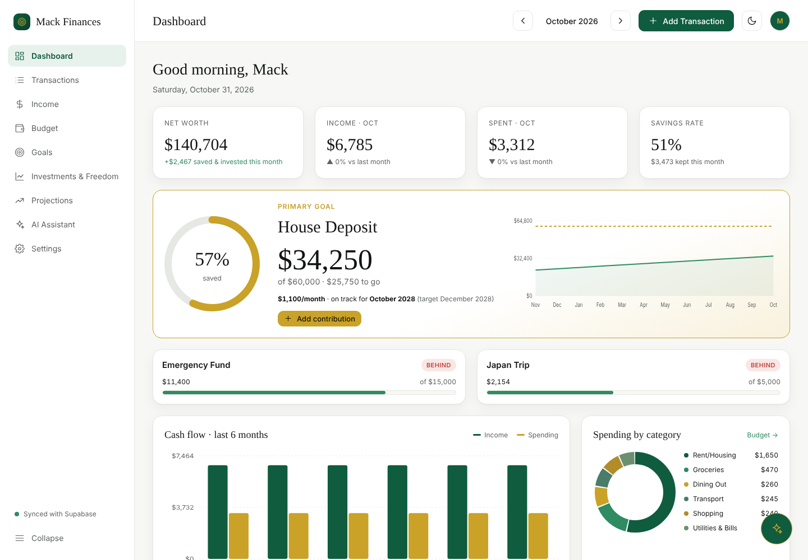
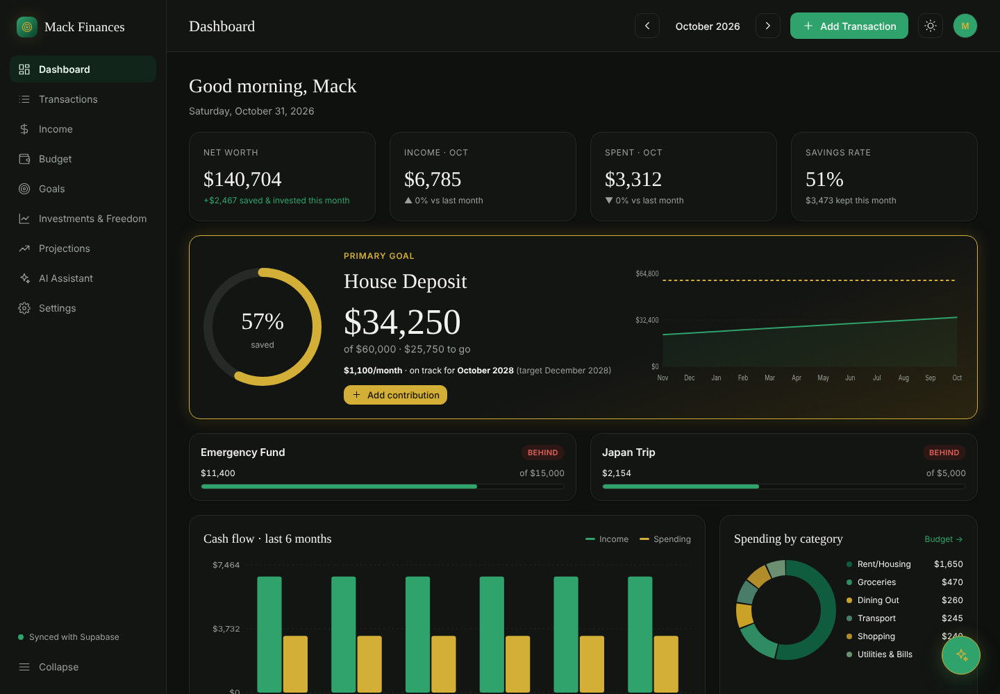
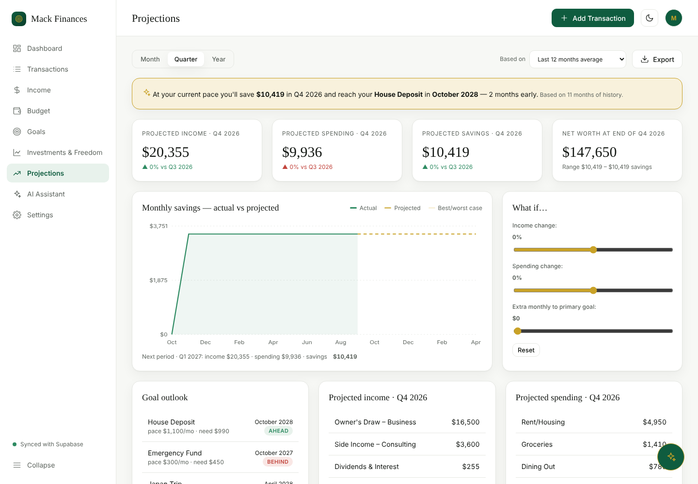
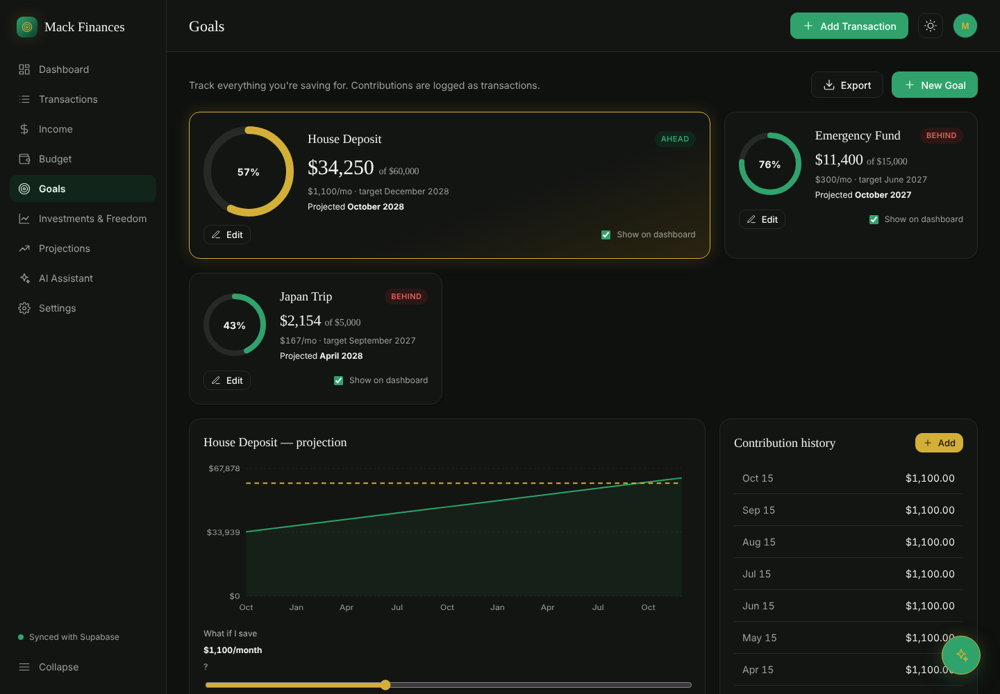
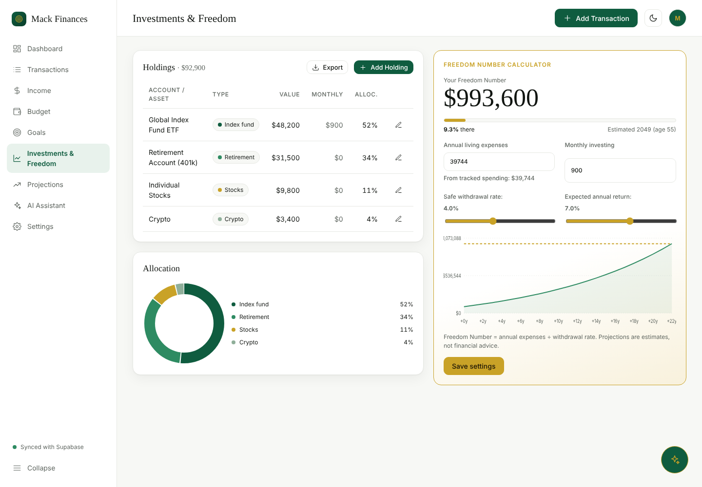

# Mack Finances

This is my **Mack Finances** website: a private personal finance dashboard for tracking my income (business draws, side income, dividends), spending, budgets, savings goals like a house deposit, investments, and my "Freedom Number", with projections by month, quarter and year, CSV export, and an AI assistant.

**Built with:** React + TypeScript (Vite) for the website · Supabase for sign-in and the database · OpenAI (via secure Supabase Edge Functions) for categorizing transactions and answering questions.

> Private project. Secrets are never stored in this repository.

## Screenshots
*(Demo data only, not real finances.)*

**Dashboard: light and dark mode**



**Projections (month / quarter / year)**


**Savings goals**


**Investments and Freedom Number**


## Run it
```bash
cd web
cp .env.example .env        # then fill in your Supabase URL + publishable key (Project Settings -> API)
npm install
npm run dev                 # http://localhost:5173
```
**Easiest on Windows:** double-click `web/start-mack-finances.bat`.

**Import into Bolt:** open this GitHub repo in Bolt (or drag the `web/` folder in). `.bolt/prompt` tells Bolt the security rules to keep.

**OpenAI key:** Supabase Dashboard → Edge Functions → Secrets → add `OPENAI_API_KEY` (optional `OPENAI_MODEL`, default `gpt-4o-mini`). It is never in the frontend. Without it, the app works fully and AI features show "unavailable".

**Email confirmation:** Supabase requires email confirmation by default. For personal use you can turn it off in Auth → Providers → Email.

## Structure
```
supabase/migrations/   schema, RLS, views, signup trigger, demo seeder (already applied to project nbrzciuukdpedtsdlhrb)
supabase/functions/    ai-categorize, ai-summary (deployed)
web/src/lib/           money.ts (integer cents), dates.ts (local dates), calc.ts (projections, freedom number, CSV), api.ts
web/src/pages/         Login, Setup, Dashboard, Transactions, Income, Budget, Goals, Investments, Projections, Assistant, Settings, Export
web/e2e/live.spec.ts   live end-to-end tests: UI → real Supabase
web/tests/             offline unit + UI tests (mock client) used during development
docs/screenshots/      app screenshots (demo data, light & dark)
```

## Risk controls
| Risk | How it's handled |
|---|---|
| OpenAI key exposure | Only in Edge Function secret; `supabase.functions.invoke` from the client |
| Missing RLS | RLS + 4 policies (`user_id = auth.uid()`) on every table; views are `security_invoker`; composite FKs stop cross-user references; anon revoked |
| Money as floats | `numeric(12,2)` in DB; integer cents in the browser; amounts sent as exact strings |
| Month boundaries / time zones | `txn_date date` with **no server default**; client sends local `YYYY-MM-DD`; profile stores time zone |
| AI category drift | User's category list passed as a JSON-schema `enum`; server rejects anything else; manual override saved as `category_origin='manual'` |
| Data sent to OpenAI | Categorize: description only. Summary: per-category / per-source totals + goal totals only |

## Tests
```bash
# Live (needs two confirmed test users)
E2E_USER_A=... E2E_PASS_A=... E2E_USER_B=... E2E_PASS_B=... npx playwright test
```
